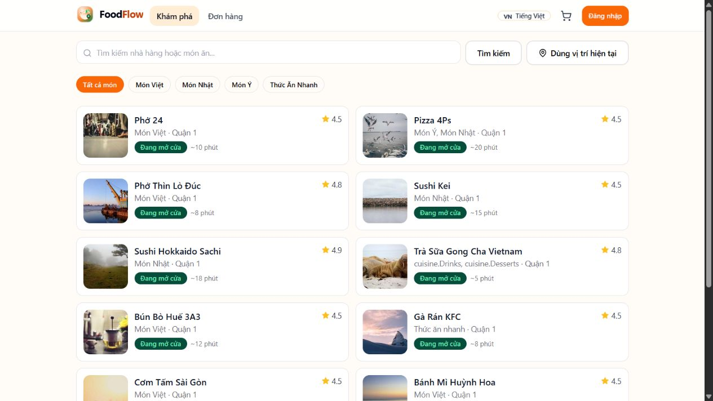
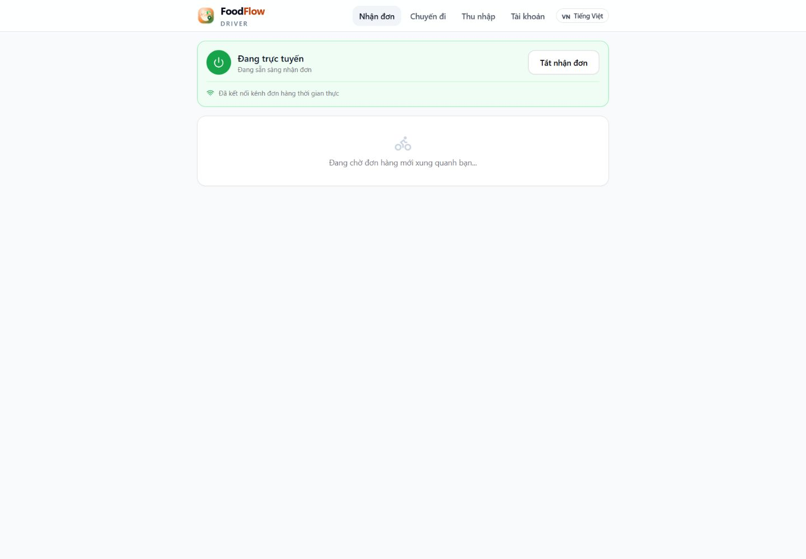
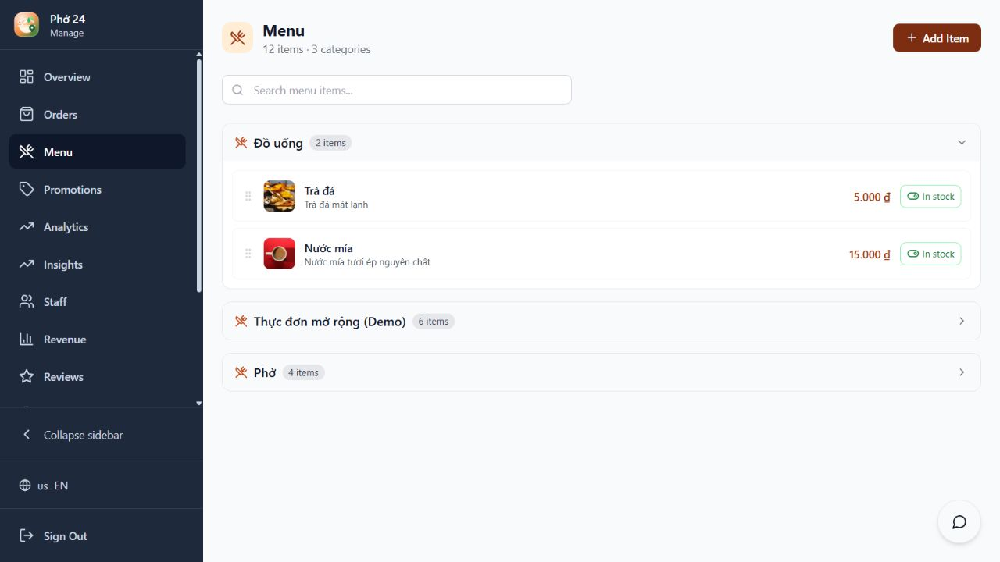
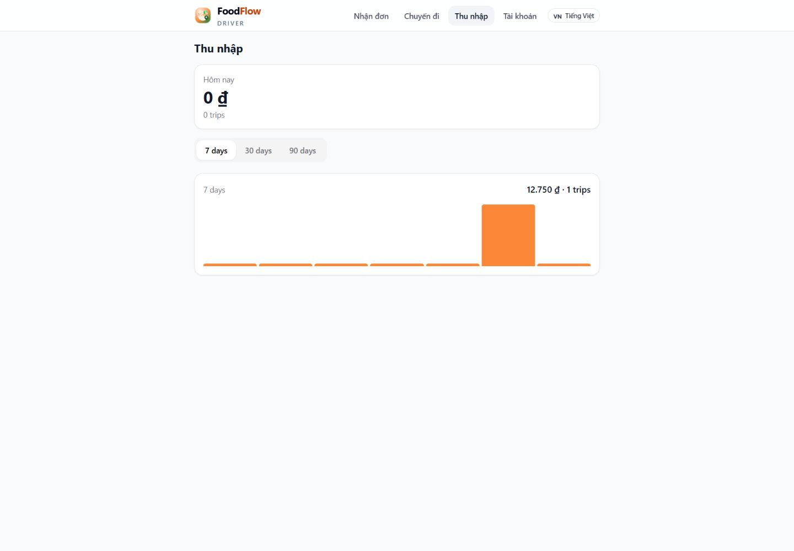
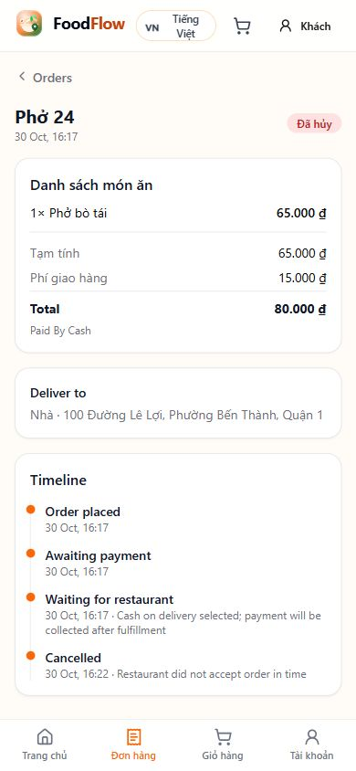
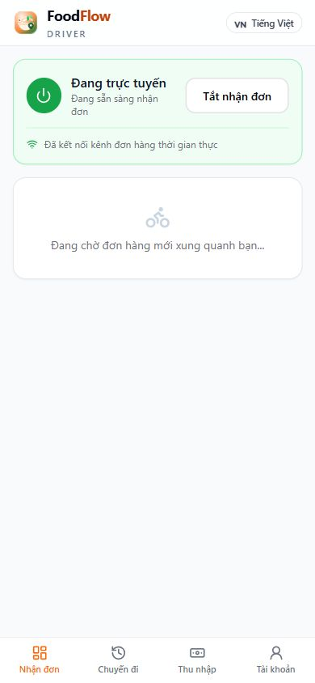
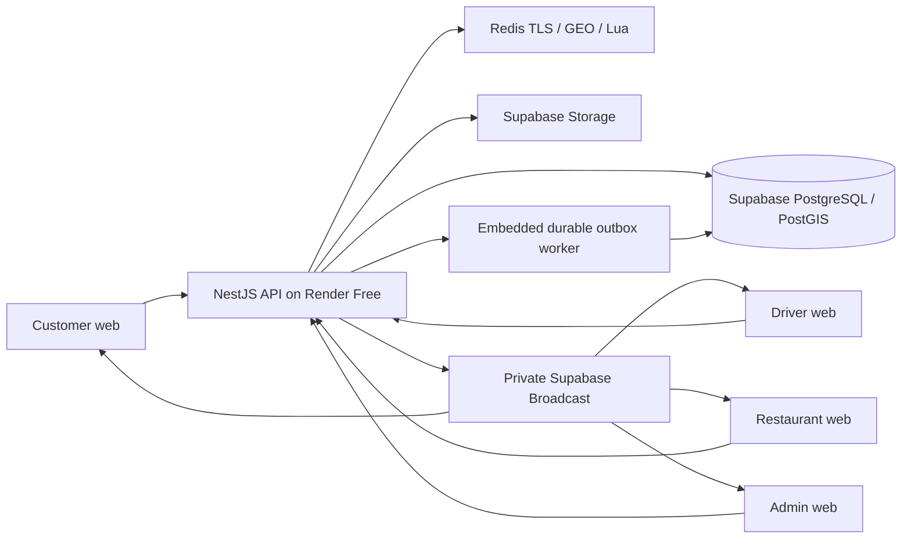

# FoodFlow · Food Delivery Operations

**Four web roles, one delivery workflow.** FoodFlow connects customer ordering, restaurant operations, driver trips and platform administration through a NestJS API, PostgreSQL/PostGIS, private realtime channels and durable background jobs.

[](https://github.com/JasonTM17/FoodDelivery_App/actions/workflows/ci.yml)
[](https://github.com/JasonTM17/FoodDelivery_App/actions/workflows/integration.yml)
[](LICENSE)

[Tiếng Việt](docs/readme.vi.md) · [日本語](docs/readme.ja.md) · [Production check](docs/production-web-check.md) · [Screenshot provenance](docs/showcase/README.md)

## Try the four web apps

| Role | Live demo | Main journey |
| --- | --- | --- |
| Customer | [Order food](https://foodflow-customer.vercel.app/) | Discover restaurants → menu → cart → COD checkout → order tracking |
| Driver | [Driver web](https://foodflow-driver.vercel.app/dashboard) | Availability, scoped realtime connection, trip history and earnings |
| Restaurant | [Restaurant portal](https://foodflow-restaurant-ochre.vercel.app/en/login) | Order queue, menu management and revenue overview |
| Admin | [Admin dashboard](https://foodflow-admin-two.vercel.app/en/login) | System overview, orders, restaurants, users and drivers |

Authenticated screenshots use synthetic demo accounts. Passwords and tokens are not published. The source also contains separate Flutter Customer/Driver apps; the images below show the **Next.js web apps**.

## See the ordering journey


Captured from production on **30 October 2026**. The walkthrough sequences real browser keyframes with edited pacing. It is not a speed benchmark. The COD order, address, restaurant activity and financial figures are synthetic portfolio fixtures; no real payment or delivery occurred.

## Four roles in view

| Customer discovery | Restaurant order queue |
| --- | --- |
|  |  |

| Admin overview | Driver dashboard |
| --- | --- |
|  |  |

<details>
<summary>Operations walkthrough, menu, earnings and mobile layouts</summary>


| Restaurant menu | Driver earnings |
| --- | --- |
|  |  |

<p>


</p>

</details>

The current API returned **20 restaurants and 140 menu items** during this check. Menu prices, ratings, reviews, estimated times and earnings are demo data, not official brand offerings or measured commercial results.

## Engineering highlights

- **Order lifecycle:** persisted cart and COD checkout; explicit state transitions and Prisma transactions across customer, restaurant and driver workflows.
- **Authorization:** JWT authentication, role checks, restaurant membership/permissions and ownership checks for orders, tracking and resources.
- **Private realtime:** short-lived ES256 credentials restrict Supabase Broadcast subscriptions; web clients renew credentials and reject stale callbacks after session changes.
- **Dispatch and durability:** Redis GEO/Lua atomic claims, idempotency and PostgreSQL outbox jobs; GPS writes are persisted before acknowledgement. The live driver screen shows connection/availability separately from delivery completion.
- **Storage:** Supabase public/private buckets, server-side upload validation and scoped signed reads for private driver documents. No real identity document is used in this showcase.
- **Recovery:** expired Admin/Restaurant sessions complete bootstrap and return to login rather than leaving an empty screen; focused regressions cover token cleanup and stale-login races.
- **Testing:** backend Jest/PostgreSQL/Redis checks, four-app Vitest suites, Playwright and Docker-based integration gates. Historical provider checks and fresh browser checks are identified separately.

## Stack and architecture

| Layer | Technologies |
| --- | --- |
| API | Node.js, NestJS 11, TypeScript, Prisma 6, REST/OpenAPI |
| Four web apps | Next.js 15, React 18, Tailwind CSS, TanStack Query where used |
| Data and location | Supabase PostgreSQL, PostGIS, Redis with TLS |
| Managed events and files | Supabase private Broadcast and Storage, PostgreSQL outbox |
| Mobile workspace | Flutter/Riverpod Customer and Driver apps, separate from these web captures |
| Verification | Jest, Vitest, Playwright, k6, Lighthouse, GitHub Actions |
| Free demo hosting | Four Vercel frontends + Render API/embedded worker |



The free demo uses `REALTIME_PROVIDER=supabase`, `STORAGE_PROVIDER=supabase` and `QUEUE_PROVIDER=supabase-postgres`. Local/self-hosted compatibility retains Socket.IO, BullMQ and MinIO. Database, service-role, signing and Redis credentials remain server-only.

## Run locally

Requirements: Node.js 22.13+, Corepack/pnpm 11.11.0 and Docker Compose. Copy the checked-in environment examples to ignored local files and configure local values before starting services.

```sh
# Infrastructure only, using the local compatibility profile
docker compose up -d --build postgres redis minio

cd backend
corepack pnpm install --frozen-lockfile
corepack pnpm prisma generate
corepack pnpm prisma migrate dev
corepack pnpm db:seed
corepack pnpm start:dev
```

In another terminal:

```sh
cd web
corepack pnpm install --frozen-lockfile
corepack pnpm dev
```

| App | Local port |
| --- | --- |
| Admin | 3000 |
| API | 3001 |
| Restaurant | 3002 |
| Customer | 3003 |
| Driver | 3004 |

Seed only an explicitly selected disposable local database. Do not apply development synchronization, resets or seed commands to a hosted database. See the [backend environment guide](backend/README.md), [web guide](web/README.md), [local Docker guide](docs/docker-local-dev-guide.md) and [managed demo setup](docs/hosted-demo.md).

## Verification and current limits

```sh
cd backend
corepack pnpm typecheck
corepack pnpm lint
corepack pnpm test -- --runInBand
corepack pnpm build
```

```sh
cd web
corepack pnpm typecheck
corepack pnpm lint
corepack pnpm test
corepack pnpm build
```

The [dated four-web production report](docs/production-web-check.md) records current deployment identities, role login/read checks, a newly persisted COD order visible to Customer/Restaurant/Admin, negative authorization and responsive observations. A green CI run proves its named scope; it does not certify all routes or provider integrations.

- **Render Free sleeps:** API and embedded worker pause after inbound idle time; durable jobs resume on HTTP wake. There is no continuous-worker or uptime guarantee, paid upgrade or artificial keepalive.
- **Providers:** live SePay, SMTP, SMS, push, AI and external route-provider success are not established by this check. Map display is distinct from verified directions, GPS or ETA. This pass does not simulate a fresh physical driver trip.
- **Locales:** Admin/Restaurant support locale routes; mixed labels remain on some Customer/Driver screens. Three-language completeness is not claimed by the screenshot gallery.
- **Release identity:** web apps and API can have different revision metadata. This report is a dated demo check, not a claim of a unified immutable release across all runtimes.

## Project map and documentation

```text
backend/             NestJS modules, Prisma schema/migrations and worker
web/apps/admin/      Platform operations
web/apps/restaurant/ Merchant operations
web/apps/customer/   Customer ordering
web/apps/driver/     Driver operations
web/packages/        Shared API client, UI and localization
mobile/              Flutter Customer/Driver applications
infra/               Containers, integration gates and deployment helpers
docs/showcase/       Dated production web media and asset manifest
```

[Admin guide](docs/admin-guide.md) · [Restaurant guide](docs/restaurant-guide.md) · [Customer guide](docs/customer-guide.md) · [Driver guide](docs/driver-guide.md) · [API contract](docs/api-contract.md) · [Testing](docs/testing-guide.md) · [Security](docs/security-audit-guide.md).

Earlier Railway, two-web, mobile-emulator and immutable-image evidence remains available in the [historical README snapshot](docs/readme-history.en.md) and [release records](docs/release/README.md). Those snapshots do not override the current Render/Vercel demo report. [MIT license](LICENSE).
