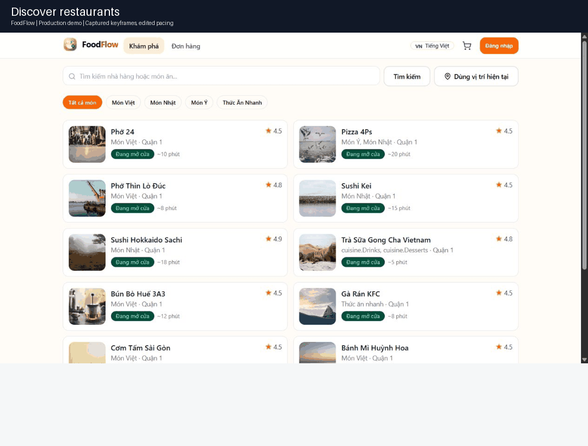
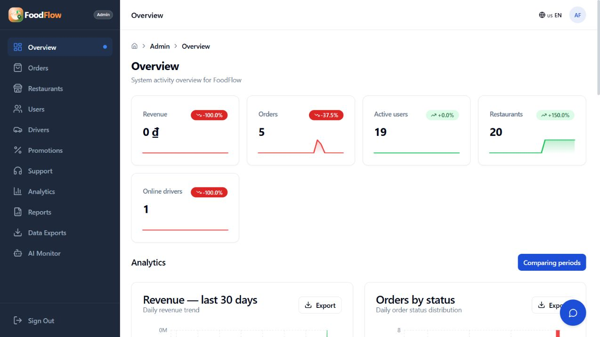
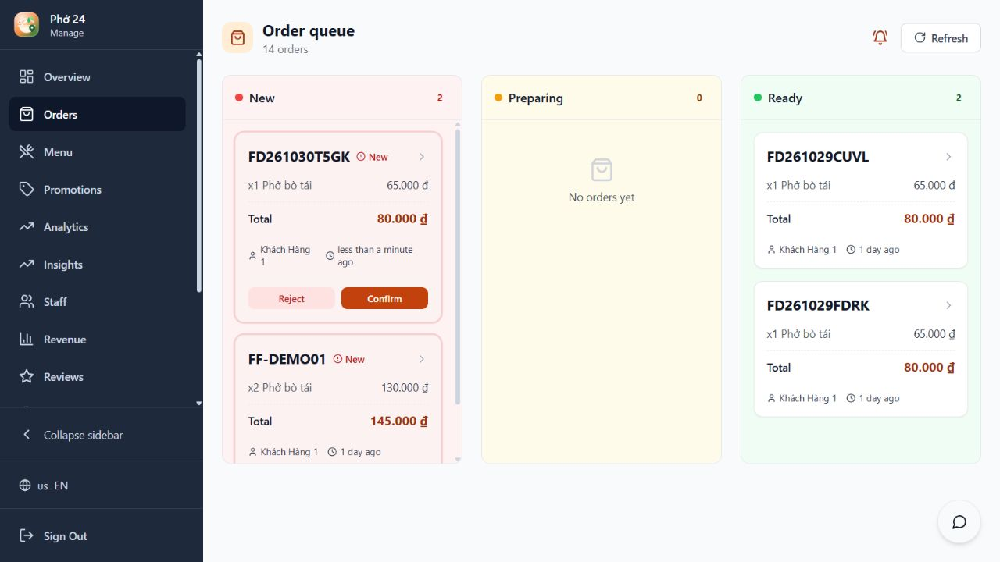
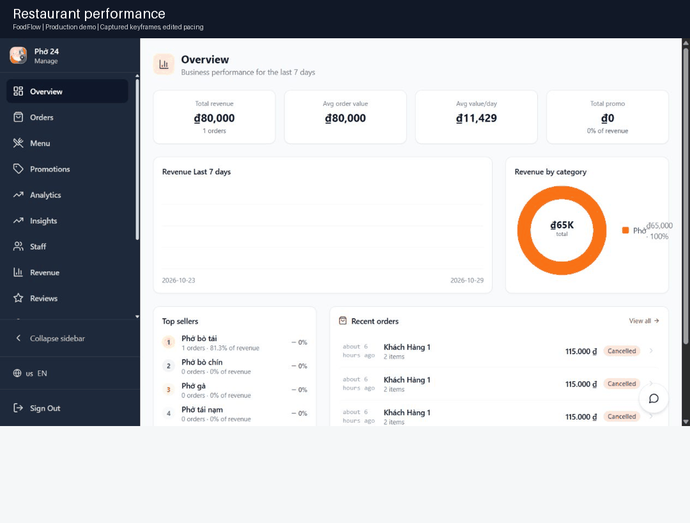

# FoodFlow · フードデリバリー運営プラットフォーム

[English](../README.md) · [Tiếng Việt](readme.vi.md) · **日本語**

FoodFlowは顧客・配達員・飲食店・管理者向けの4つのNext.js WebとNestJS APIを備えた学習用プロジェクトです。Supabase PostgreSQL/PostGIS、非公開Broadcast、Storage、Redisを利用し、注文状態管理と永続的なバックグラウンド処理を実装しています。Flutter版は別の実装です。以下の画像はWeb版です。

| 役割 | デモ |
| --- | --- |
| 顧客 | [注文Web](https://foodflow-customer.vercel.app/) |
| 配達員 | [配達員Web](https://foodflow-driver.vercel.app/dashboard) |
| 飲食店 | [店舗ポータル](https://foodflow-restaurant-ochre.vercel.app/en/login) |
| 管理者 | [管理画面](https://foodflow-admin-two.vercel.app/en/login) |

## 注文フロー

2026年10月30日の実際のデモ操作から取得したキーフレームです。表示時間は編集済みで、速度測定ではありません。20店舗・140商品をAPIで確認しました。注文、住所、価格、評価、収入は模擬データであり、実際の支払い・配達・商取引は行っていません。

| 管理者 | 飲食店 |
| --- | --- |
|  |  |

## 技術と検証

- NestJS11、TypeScript、Prisma6、PostgreSQL/PostGIS、Redis TLS/GEO/Lua。
- Next.js15、React18、Tailwind CSS、共有APIクライアント。
- JWT、ロール、店舗権限、注文所有者による認可。
- 短時間のES256 JWTによるSupabase private Broadcast、セッション更新と古いコールバックの排除。
- Prismaトランザクション、注文状態遷移、冪等性、Postgres outbox、応答前のGPS永続化。
- Jest、Vitest、Playwright、実PostgreSQL/RedisとDocker integration。

4つのWebはVercel、APIとembedded workerはRender Freeで稼働します。15分の無通信でサービスがスリープする場合があり、その間のジョブ処理も停止します。再開後に永続ジョブが続行されます。連続稼働は保証しません。

[今回の検証記録](production-web-check.md)は各ロールのログイン、注文保存と画面間の一致、認可の拒否、mobile390pxの観察を区別します。全機能・全端末の認証ではありません。外部決済、SMTP、push/SMS、AI、経路providerの成功は未検証です。一部画面には言語の混在が残ります。WebとAPIのrevisionは異なる場合があります。

ローカル構築と検証コマンドは[英語README](../README.md#run-locally)、[Webガイド](../web/README.md)、[backendガイド](../backend/README.md)を参照してください。[画像の出典](showcase/README.md) · [過去のREADME](readme-history.ja.md) · [MIT](../LICENSE)。
