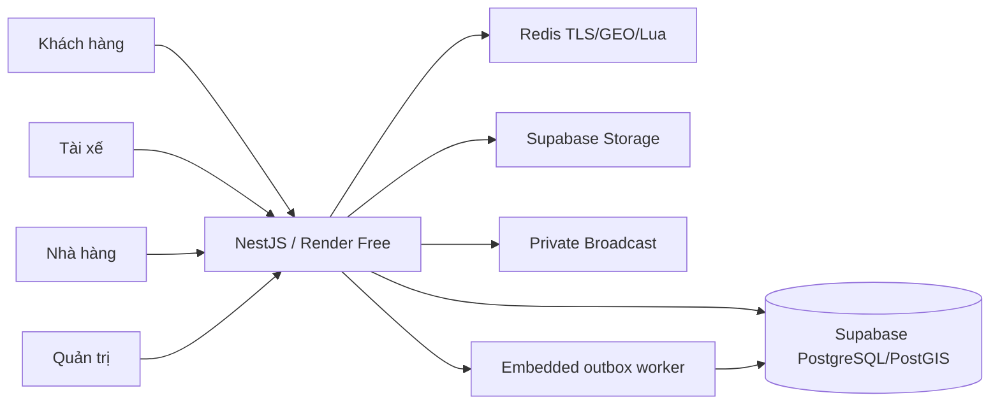

# FoodFlow · Nền tảng vận hành giao đồ ăn

[English](../README.md) · **Tiếng Việt** · [日本語](readme.ja.md)

FoodFlow kết nối đặt món, xử lý đơn tại nhà hàng, công việc tài xế và quản trị hệ thống bằng **NestJS API cùng bốn web Next.js**, PostgreSQL/PostGIS, Supabase Realtime/Storage và Redis. Dự án còn có hai ứng dụng Flutter riêng; ảnh dưới đây là giao diện web đang triển khai.

## Trải nghiệm bốn vai trò

| Vai trò | Web production | Luồng chính |
| --- | --- | --- |
| Khách hàng | [Đặt món](https://foodflow-customer.vercel.app/) | Khám phá → menu → giỏ → COD → theo dõi đơn |
| Tài xế | [Web tài xế](https://foodflow-driver.vercel.app/dashboard) | Trạng thái nhận đơn, kênh realtime, chuyến đi và thu nhập |
| Nhà hàng | [Cổng nhà hàng](https://foodflow-restaurant-ochre.vercel.app/en/login) | Hàng đợi đơn, menu và tổng quan doanh thu |
| Quản trị | [Dashboard](https://foodflow-admin-two.vercel.app/en/login) | Tổng quan, đơn hàng, nhà hàng, người dùng và tài xế |

Ảnh sử dụng tài khoản và dữ liệu mô phỏng. Không công khai mật khẩu/token; không gửi giấy tờ thật, thanh toán hay giao hàng thật.

## Luồng đặt món trên production


GIF ghép từ các khung hình thao tác thật ngày **30/10/2026**, có biên tập nhịp hiển thị; không dùng để đo tốc độ tải. API hiện trả **20 nhà hàng, 140 món**. Giá, đánh giá, thời gian dự kiến, lượt bán và thu nhập là dữ liệu demo, không phải hoạt động thương mại hay thực đơn chính thức của thương hiệu.

| Khám phá nhà hàng | Xử lý đơn tại quán |
| --- | --- |
|  |  |

| Quản trị | Tài xế |
| --- | --- |
|  |  |

<details>
<summary>Xem GIF vận hành và giao diện mobile</summary>


</details>

## Kỹ thuật áp dụng

- JWT, vai trò, quyền nhân viên theo nhà hàng và quyền sở hữu đơn; kiểm tra từ chối truy cập trái vai trò.
- State machine đơn hàng, transaction Prisma, idempotency và Postgres outbox cho xử lý nền bền vững.
- Supabase Broadcast riêng với JWT ES256 ngắn hạn theo kênh; tự gia hạn và chặn callback cũ sau khi phiên thay đổi.
- Redis GEO/Lua cho điều phối, nhận đơn nguyên tử; lưu GPS trước khi trả xác nhận. Ảnh tài xế không chứng minh một chuyến giao thật.
- Supabase Storage công khai/riêng tư, kiểm tra upload ở server và signed URL theo quyền.
- Kiểm thử Jest, PostgreSQL/Redis, Vitest cho bốn web, Playwright và các cổng integration Docker.

## Công nghệ và hosting

| Thành phần | Công nghệ |
| --- | --- |
| Backend | Node.js, NestJS 11, TypeScript, Prisma 6, REST/OpenAPI |
| Bốn web | Next.js 15, React 18, Tailwind CSS, TanStack Query tại các phần sử dụng |
| Dữ liệu | Supabase PostgreSQL/PostGIS, Redis TLS |
| Sự kiện và tệp | Supabase private Broadcast/Storage, Postgres outbox |
| Mobile riêng | Flutter/Riverpod |
| Bản demo miễn phí | Bốn web Vercel, API và embedded worker trên Render Free |



## Chạy và kiểm tra local

Cần Node.js22.13+, pnpm11.11.0 và Docker. Sao chép các tệp môi trường ví dụ sang tệp local bị Git ignore, cấu hình giá trị local rồi chạy:

```sh
docker compose up -d --build postgres redis minio
cd backend
corepack pnpm install --frozen-lockfile
corepack pnpm prisma generate
corepack pnpm prisma migrate dev
corepack pnpm db:seed
corepack pnpm start:dev
```

Terminal khác: `cd web`, `corepack pnpm install --frozen-lockfile`, `corepack pnpm dev`. Admin3000, API3001, Nhà hàng3002, Khách hàng3003, Tài xế3004. Chỉ seed database local có thể tạo lại; không reset/seed database hosted.

Xem [README tiếng Anh](../README.md#verification-and-current-limits) để lấy lệnh typecheck/lint/test/build, [hướng dẫn web](../web/README.md), [backend](../backend/README.md) và [managed demo](hosted-demo.md).

## Kết quả và giới hạn

[Báo cáo kiểm tra bốn web](production-web-check.md) ghi nhận đăng nhập cả bốn vai trò, dữ liệu thật qua API, một đơn COD mới hiện ở Khách hàng/Nhà hàng/Quản trị, quyền sở hữu đơn, quyền cấp realtime và kiểm tra mobile390px. Bản sửa phiên hết hạn giúp Admin/Restaurant trở về đăng nhập thay vì trắng trang; không đồng nghĩa mọi chức năng đã được chứng nhận.

Render Free có thể ngủ sau15phút không có truy cập, kéo theo worker tạm dừng; công việc bền vững tiếp tục khi API thức. Không có cam kết worker liên tục hoặc uptime. SePay, email, SMS, push, AI và directions provider chưa được chứng minh hoạt động thật trong lượt này. Một số màn hình còn nhãn trộn ngôn ngữ. Các web/API có thể mang revision khác nhau, nên không gọi đây là release đồng nhất toàn hệ thống.

[Nguồn ảnh/GIF và manifest](showcase/README.md) · [Hướng dẫn API](api-contract.md) · [Kiểm thử](testing-guide.md) · [Bảo mật](security-audit-guide.md) · [Tài liệu lịch sử](readme-history.vi.md) · [MIT](../LICENSE).
